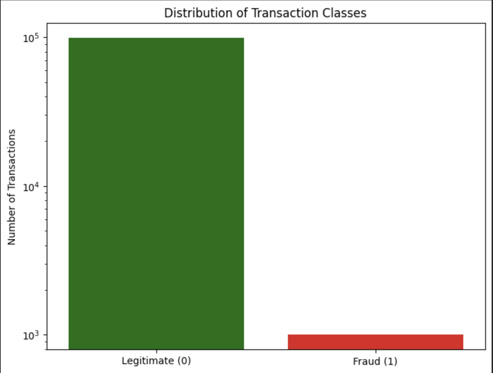
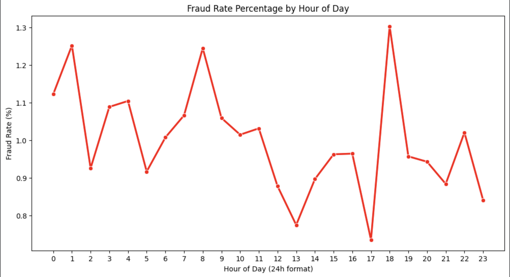
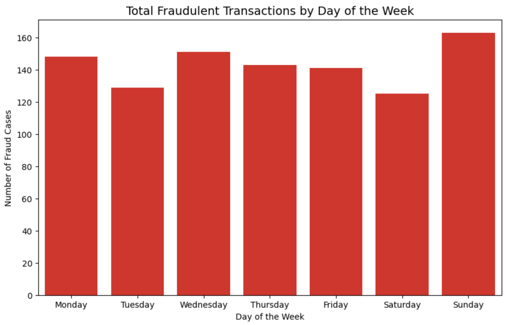
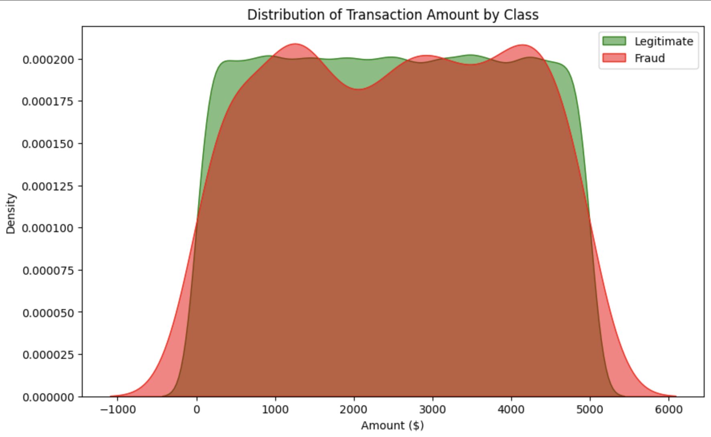
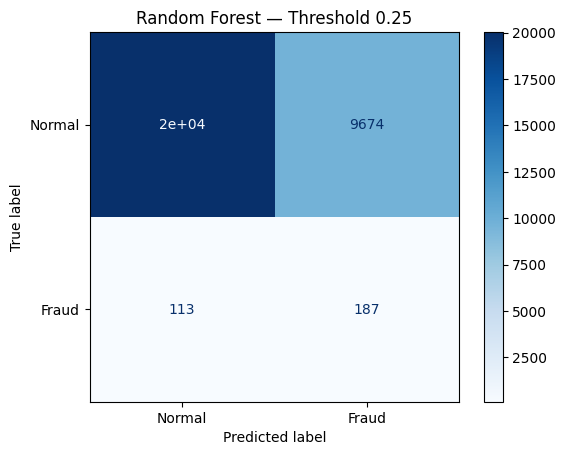

# Credit Card Fraud Detection

A binary classifier for credit card fraud on a highly imbalanced dataset (1% fraud), built with scikit-learn and imbalanced-learn. The project compares a logistic regression baseline with a random forest, and studies how the decision threshold changes the balance between fraud caught and false alarms.

**Status:** coursework project. Results come from a single train/test split and the model has low precision (see [Limitations](#limitations)). It is not intended for production use.

## Table of contents

- [Overview](#overview)
- [Problem statement](#problem-statement)
- [Dataset](#dataset)
- [Pipeline](#pipeline)
- [Results](#results)
- [Limitations](#limitations)
- [Installation](#installation)
- [Quick start](#quick-start)
- [Usage examples](#usage-examples)
- [Configuration](#configuration)
- [Project structure](#project-structure)
- [Technical notes](#technical-notes)
- [License](#license)
- [Authors](#authors)
- [References](#references)

## Overview

The pipeline parses transaction dates, builds time-based and merchant-based features, scales amount features with `RobustScaler`, balances the training set with SMOTE, and trains two models: a logistic regression baseline and a random forest. It then searches a range of probability thresholds and selects the one with the highest F1 score among those that reach at least 60% recall.

Main finding: lowering the threshold from the default 0.50 to the selected 0.25 raised the number of frauds caught from 110 to 187 (out of 300 in the test set), and raised false alarms from 4,997 to 9,674. Each additional fraud caught cost about 60 additional false alarms. Precision at the selected threshold is 1.9%.

## Problem statement

1. **Class imbalance.** Fraud is 1% of transactions (99:1).
2. **Default threshold.** On imbalanced data a 0.50 cutoff favors the majority class. In this project it caught 36.7% of fraud in the test set.
3. **Outliers.** Transaction amounts vary widely, so scaling uses median and IQR instead of mean and standard deviation.
4. **Trade-off.** Catching more fraud (recall) produces more false alarms (lower precision), and the right balance depends on what each kind of error costs.
5. **Time and merchant patterns.** The feature set tests whether hour, day, and merchant history carry signal.

## Dataset

Source: [Kaggle Credit Card Fraud Detection dataset (bhadramohit)](https://www.kaggle.com/datasets/bhadramohit/credit-card-fraud-detection/data). See the Kaggle page for how the data was produced. Results here should not be assumed to carry over to real transaction data.

| Item | Count |
|---|---|
| Total transactions | 100,000 |
| Fraudulent | 1,000 (1.00%) |
| Legitimate | 99,000 (99.00%) |
| Training set (70%, stratified) | 70,000 (700 fraud, 69,300 legitimate) |
| Test set (30%, stratified) | 30,000 (300 fraud, 29,700 legitimate) |

### Raw features

| Feature | Type | Description |
|---|---|---|
| TransactionID | Numeric | Unique transaction identifier |
| TransactionDate | Datetime | Date and time of transaction |
| Amount | Numeric | Transaction amount |
| MerchantID | Categorical | Merchant identifier |
| TransactionType | Categorical | Type of transaction |
| Location | Categorical | Geographic location |
| IsFraud | Binary | Target (0 = legitimate, 1 = fraud) |

### Derived features

| Feature | Source | Purpose |
|---|---|---|
| Hour | TransactionDate | Time-of-day pattern |
| DayOfWeek | TransactionDate | Weekly pattern |
| Month | TransactionDate | Seasonal pattern |
| Is_night | Hour | Night-time indicator |
| Is_weekend | DayOfWeek | Weekend indicator |
| Merchant_fraud_rate | Aggregation | Fraud history of the merchant |
| Merchant_tx_count | Aggregation | Transaction volume of the merchant |
| Merchant_avg_amount | Aggregation | Typical amount at the merchant |
| Amount_vs_merchant_avg | Derived | Amount relative to the merchant's average |
| TransactionType_encoded | Encoding | Categorical to numeric |
| Location_encoded | Encoding | Categorical to numeric |

### Exploratory plots

Plots are in `src/visualization/`. The observations below describe the plots and are not statistical tests. With only 1,000 fraud cases, differences between individual hours or days may be noise.

- **Class distribution** (log scale): about 99,000 legitimate and 1,000 fraudulent transactions.
- **Fraud rate by hour:** the plot shows higher rates around 1 AM, 6 PM, and 8 AM and lower rates around 1 PM and 5 PM.
- **Fraud by day of week:** the plot shows the most fraud on Sunday and the least on Saturday.
- **Amount distribution by class:** fraud and legitimate amounts have similar distributions, so amount alone separates the classes poorly.






## Pipeline

1. Load `data/raw/credit_card_fraud_dataset.csv`.
2. Parse dates, create time features, and encode `TransactionType` and `Location`.
3. Build merchant statistics and the engineered amount feature.
4. Split 70/30, stratified on `IsFraud` (`random_state=42`).
5. Fit `RobustScaler` on the training set and apply it to both sets.
6. Apply SMOTE to the training set only: fraud goes from 700 to 69,300 samples, matching the 69,300 legitimate ones. The test set keeps its natural 1% fraud rate.
7. Train a logistic regression baseline (`class_weight='balanced'`, `max_iter=1000`).
8. Train a random forest (200 trees, `max_depth=20`, `min_samples_split=10`, `min_samples_leaf=5`, `class_weight='balanced'`).
9. Evaluate thresholds from 0.10 to 0.65 in steps of 0.05 (12 values) and select the highest F1 among thresholds with recall of at least 0.60.
10. Report the confusion matrix, classification metrics, and model comparison, and save the model, preprocessor, and threshold.

Threshold search:

```python
for threshold in np.arange(0.10, 0.70, 0.05):   # 0.10 ... 0.65
    preds = (y_proba >= threshold).astype(int)
    recall = TP / (TP + FN)
    precision = TP / (TP + FP)
    f1 = 2 * precision * recall / (precision + recall)
    # keep the threshold with the highest F1 where recall >= min_recall
```

## Results

All numbers are for the random forest on the 30,000-transaction test set (300 fraud, 29,700 legitimate).

### Threshold search

| Threshold | Recall | Precision | F1 | False alarms | Fraud caught | Recall >= 0.60 |
|---|---|---|---|---|---|---|
| 0.10 | 0.85 | 0.0170 | 0.0333 | 14,724 | 254 | Yes |
| 0.15 | 0.77 | 0.0178 | 0.0347 | 12,768 | 231 | Yes |
| 0.20 | 0.70 | 0.0186 | 0.0361 | 11,163 | 211 | Yes |
| **0.25** | **0.62** | **0.0190** | **0.0368** | **9,674** | **187** | **Yes (selected)** |
| 0.30 | 0.56 | 0.0192 | 0.0371 | 8,537 | 167 | No |
| 0.35 | 0.50 | 0.0195 | 0.0375 | 7,554 | 150 | No |
| 0.40 | 0.44 | 0.0194 | 0.0372 | 6,617 | 131 | No |
| 0.45 | 0.40 | 0.0208 | 0.0395 | 5,709 | 121 | No |
| 0.50 (default) | 0.37 | 0.0215 | 0.0407 | 4,997 | 110 | No |
| 0.55 | 0.32 | 0.0212 | 0.0397 | 4,438 | 96 | No |
| 0.60 | 0.30 | 0.0220 | 0.0411 | 4,039 | 91 | No |
| 0.65 | 0.27 | 0.0215 | 0.0398 | 3,687 | 81 | No |

F1 is low at every threshold because precision stays near 2%. Among thresholds that meet the 60% recall requirement, 0.25 has the highest F1.

### Model comparison

| Metric | Logistic regression | Random forest (threshold 0.25) |
|---|---|---|
| Accuracy | 0.67 | 0.67 |
| Recall | 0.66 | 0.62 |
| Precision | not recorded | 0.019 |
| F1 | 0.04 | 0.04 |
| ROC-AUC | 0.73 | 0.72 |

The two models perform about the same, so the random forest adds complexity without a measurable gain on this dataset.

### Confusion matrix (random forest, threshold 0.25)

|  | Predicted legitimate | Predicted fraud |
|---|---|---|
| Actual legitimate | 20,026 | 9,674 |
| Actual fraud | 113 | 187 |

- Recall: 187 / 300 = 62.3%
- Precision: 187 / 9,861 = 1.9%
- False alarm rate: 9,674 / 29,700 = 32.6%
- Accuracy: 20,213 / 30,000 = 67.4%



### Cost of lowering the threshold

Moving from 0.50 to 0.25 caught 77 more frauds (110 to 187) and added 4,677 false alarms (4,997 to 9,674), about 60 extra false alarms per additional fraud caught.

## Limitations

- **Threshold chosen on the test set.** The threshold search and the final evaluation use the same test data, so the reported test numbers are optimistic. A validation split or cross-validation would fix this.
- **Low precision.** At the selected threshold about 52 alerts are false for each real fraud. Alerts would need a review step before any action.
- **Weak discrimination.** ROC-AUC is about 0.72, and the random forest does not beat the logistic regression baseline.
- **Small number of fraud cases.** With 300 frauds in the test set, a recall of 62.3% has a 95% binomial interval of roughly plus or minus 5.5 percentage points. Results come from one split and one random seed.
- **No ablations.** SMOTE, `RobustScaler`, and the engineered features were not tested against alternatives, so this README makes no claims about how much each one helps.
- **Dataset.** The data is a public Kaggle dataset. Performance on real transaction data is unknown.

## Installation

```bash
git clone https://github.com/Ramesh-Bartaula/Credit_Card_Fraud_Detection_ML_Project.git
cd Credit_Card_Fraud_Detection_ML_Project

# macOS/Linux
python3 -m venv venv
source venv/bin/activate

# Windows
python -m venv venv
venv\Scripts\activate

pip install --upgrade pip
pip install -r requirements.txt
```

### Download the dataset

The project expects the file at `data/raw/credit_card_fraud_dataset.csv`.

**Manual:** download the CSV from the [Kaggle dataset page](https://www.kaggle.com/datasets/bhadramohit/credit-card-fraud-detection/data), then save it as `data/raw/credit_card_fraud_dataset.csv`.

**Kaggle CLI** (if configured):

```bash
kaggle datasets download -d bhadramohit/credit-card-fraud-detection
unzip credit-card-fraud-detection.zip -d data/raw/
```

Rename the extracted CSV to `credit_card_fraud_dataset.csv` if its name differs.

### Check the installation

```bash
python -c "import pandas, sklearn, imblearn, joblib, yaml; print('All dependencies installed')"
```

## Quick start

```bash
python main.py
```

The script loads the data, preprocesses it, applies SMOTE to the training set, trains both models, tests 12 thresholds, selects the best one under the 60% recall rule, and saves the model, preprocessor, and threshold. The console shows the dataset shape, class counts before and after SMOTE, the threshold table, and evaluation metrics for both models. Reference results are in [Results](#results).

## Usage examples

### Programmatic training

```python
from src.models.train_model import train_fraud_model

train_fraud_model()
```

### Load and predict

New transactions must go through the same preprocessing (encoders, merchant statistics, scaler) before prediction.

```python
import joblib

model = joblib.load('models/fraud_model.pkl')
preprocessor_data = joblib.load('models/artifacts/preprocessor.joblib')
best_threshold = joblib.load('models/artifacts/best_threshold.joblib')

# new_transaction_prepared: output of the saved preprocessing steps
proba = model.predict_proba(new_transaction_prepared)[:, 1]
prediction = (proba >= best_threshold).astype(int)
```

### Compare thresholds

```python
thresholds = {
    'aggressive': 0.15,    # recall 0.77
    'selected': 0.25,      # recall 0.62
    'conservative': 0.40,  # recall 0.44
    'default': 0.50,       # recall 0.37
}

for name, t in thresholds.items():
    pred = (proba >= t).astype(int)
    fraud_caught = ((pred == 1) & (y_true == 1)).sum()
    false_alarms = ((pred == 1) & (y_true == 0)).sum()
    print(f"{name:12} | threshold {t:.2f} | fraud caught {fraud_caught} | false alarms {false_alarms}")
```

On the test set this gives:

```
aggressive   | threshold 0.15 | fraud caught 231 | false alarms 12768
selected     | threshold 0.25 | fraud caught 187 | false alarms 9674
conservative | threshold 0.40 | fraud caught 131 | false alarms 6617
default      | threshold 0.50 | fraud caught 110 | false alarms 4997
```

## Configuration

`configs/config.yaml`

```yaml
paths:
  raw_data: 'data/raw/credit_card_fraud_dataset.csv'
  processed_data: 'data/processed/'
  model_path: 'models/fraud_model.pkl'

preprocessing:
  test_size: 0.3
  random_state: 42
  scale_columns:
    - Amount
    - Merchant_avg_amount
    - Amount_vs_merchant_avg
```

`configs/model_params.yaml`

```yaml
model_params:
  n_estimators: 200
  max_depth: 20
  min_samples_split: 10
  min_samples_leaf: 5
  max_features: 'sqrt'
  class_weight: 'balanced'
  random_state: 42
  n_jobs: -1

threshold_tuning:
  min_recall: 0.60
  threshold_range:
    start: 0.10
    end: 0.70      # exclusive, so the last threshold tested is 0.65
    step: 0.05
```

## Project structure

```
Credit_Card_Fraud_Detection_ML_Project/
├── configs/
│   ├── config.yaml
│   └── model_params.yaml
├── data/
│   └── raw/                      # credit_card_fraud_dataset.csv goes here
├── docs/
├── models/
│   └── artifacts/                # preprocessor and threshold
├── notebooks/
├── reports/
│   └── figures/
├── src/
│   ├── data/preprocessing.py     # SimpleFraudPreprocessor
│   ├── features/build_features.py  # FraudFeatureBuilder
│   ├── models/train_model.py     # training and evaluation
│   └── visualization/            # exploratory plots
├── main.py                       # entry point
├── requirements.txt
├── pyproject.toml
├── LICENSE
└── README.md
```

## Technical notes

**RobustScaler.** It centers on the median and scales by the interquartile range, so extreme values have little influence. `StandardScaler` uses the mean and standard deviation, which a single extreme value can distort. Example with one extreme value in eight: `[100, 101, 102, 103, 104, 105, 106, 1000000]` has a mean of about 125,090 and a standard deviation of about 330,685, while the median is 103.5 and the IQR is 3.5. This project did not compare the two scalers on model performance.

**SMOTE.** It creates synthetic minority-class samples by interpolating between existing fraud examples. It is applied to the training set only, so the test set keeps the real 1% fraud rate. This project did not run a model without SMOTE, so its effect on results is untested.

**Threshold tuning.** A model trained on balanced data outputs probabilities that do not match real-world fraud frequency, so a 0.50 cutoff is not special. Here the cutoff is treated as a setting and chosen by F1 subject to a minimum recall of 60%. See [Limitations](#limitations) for the caveat about tuning on the test set.

**Accuracy.** Accuracy is misleading on imbalanced data. At threshold 0.25 accuracy is 67% while precision is 1.9%, so recall and precision should be read together.

## License

MIT License. See [LICENSE](LICENSE).

## Authors

Ramesh Bartaula and Niraj K Mali

- GitHub: [@Ramesh-Bartaula](https://github.com/Ramesh-Bartaula)
- Email: basantimaya12@gmail.com or nirajmali247@gmail.com

Last updated: October 2026

## References

- Chawla, N. V., Bowyer, K. W., Hall, L. O., and Kegelmeyer, W. P. (2002). SMOTE: Synthetic Minority Over-sampling Technique. *Journal of Artificial Intelligence Research*, 16, 321-357.
- [imbalanced-learn: SMOTE](https://imbalanced-learn.org/stable/references/generated/imblearn.over_sampling.SMOTE.html)
- [scikit-learn: RobustScaler](https://scikit-learn.org/stable/modules/generated/sklearn.preprocessing.RobustScaler.html)
- [scikit-learn: RandomForestClassifier](https://scikit-learn.org/stable/modules/generated/sklearn.ensemble.RandomForestClassifier.html)
